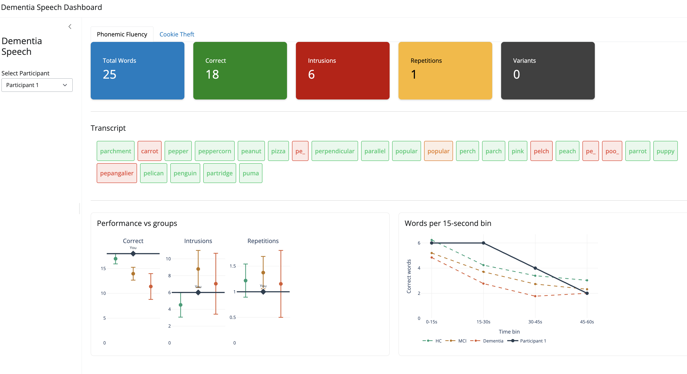
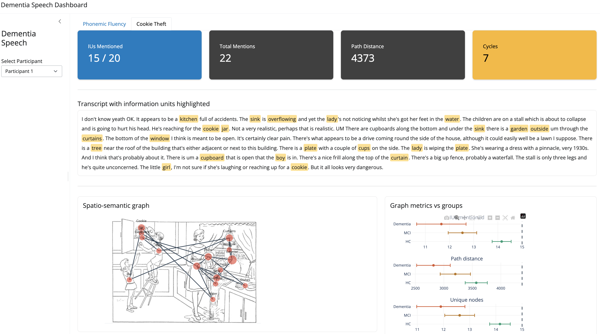

# dementia-speech

A research toolkit for scoring and visualising speech biomarkers from dementia-related clinical tasks. Currently covers two tasks:

- **Phonemic Fluency Task (PFT)** — participants produce words starting with the letter P for 60 seconds; speech is recorded and manually transcribed into Praat TextGrids.
- **Cookie Theft Picture Description (CTD)** — participants describe the Cookie Theft picture (from the Boston Diagnostic Aphasia Examination); responses are provided as plain-text transcripts.

The pipeline scores both tasks, extracts linguistic and spatial-navigational features, and displays per-participant results in an interactive dashboard for clinical or research review.

**The work is under progress and this repo does not describe a finished project**

---

## Project structure

```
dementia-speech/
├── src/dementia_speech/        # Core library (installable package)
│   ├── io/
│   │   └── textgrid.py         # Praat TextGrid parser
│   └── tasks/
│       ├── phonemic_fluency/   # PFT scoring and features
│       │   ├── rules.py        # Word classification rules
│       │   ├── scoring.py      # Trial scoring and summary metrics
│       │   └── features.py     # Temporal bin features
│       └── picture_description/
│           ├── scoring.py      # Information unit (IU) extraction
│           └── graph.py        # Spatio-semantic graph construction and metrics
├── pipelines/
│   ├── score_pft.py            # Run PFT scoring over all TextGrids
│   └── score_cookie_theft.py   # Run CTD scoring over all transcripts
├── app/
│   ├── app.py                  # Shiny dashboard entry point
│   ├── shared.py               # Shared data loading and constants
│   └── modules/
│       ├── phonemic_fluency.py # PFT dashboard tab
│       └── cookie_theft.py     # CTD dashboard tab
├── data/
│   ├── raw/
│   │   ├── meta-info.csv       # Participant IDs and diagnosis labels
│   │   ├── textgrids/PFT/      # Praat TextGrid files for PFT
│   │   └── text/CTD/           # Plain-text transcripts for CTD
│   └── processed/              # Pipeline outputs (CSVs)
├── notebooks/                  # Exploratory Jupyter notebooks
├── docs/                       # Decisions log, open issues
├── tests/
└── environment.yml
```

---

## Installation

### 1. Create the environment

```bash
conda env create -f environment.yml
conda activate dementia-speech
```

### 2. Install the package in editable mode

```bash
pip install -e .
```

---

## Data conventions

| File | Format | Key columns |
|------|--------|-------------|
| `data/raw/meta-info.csv` | CSV | `IDs` (participant ID), `diagnosis` (HC / MCI / Dementia) |
| `data/raw/textgrids/PFT/*.TextGrid` | Praat TextGrid | Tier name: `transcript/word` |
| `data/raw/text/CTD/*.txt` | Plain text | Free-form description transcript |

**Filename convention:** `<task>__<participant_id>.TextGrid` / `.txt` — the 3-digit participant ID is extracted from the second `__`-delimited segment.

The TextGrid parser automatically removes:
- Empty / whitespace-only intervals
- Bracketed annotations (e.g. `[laugh]`, `[sigh]`)
- Filled pauses (`er`, `erm`, `um`, `uh`, etc.)

---

## Pipelines

### Phonemic Fluency Task (PFT)

```bash
python pipelines/score_pft.py
```

Reads all `*.TextGrid` files from `data/raw/textgrids/PFT/` and writes:

- `data/processed/pft_words.csv` — word-level classifications per participant
- `data/processed/pft_metrics.csv` — participant-level summary metrics

**Word classifications** (applied in priority order):

| Class | Rule |
|-------|------|
| `repetition` | Exact duplicate of an earlier word |
| `variant` | Morphological variant of an earlier word (NLTK PorterStemmer) |
| `intrusion` | Does not start with the target letter (P) |
| `correct` | Valid word starting with P, not a repetition or variant |

**Summary metrics:** `total_words`, `correct`, `intrusions`, `repetitions`, `variants`, `errors`

**Temporal features:** correct word counts in four 15-second bins (`bin_1` – `bin_4`).

---

### Cookie Theft Picture Description (CTD)

```bash
python pipelines/score_cookie_theft.py
```

Reads all `*.txt` files from `data/raw/text/CTD/` and writes:

- `data/processed/cookie_theft_iu.csv` — IU-level results per participant (one row per IU)
- `data/processed/cookie_theft_metrics.csv` — participant-level coverage and graph metrics

**Information units (IUs):** 20 semantic concepts from the Cookie Theft picture (e.g. Boy, Girl, Woman, Cookie, Jar, Stool, Sink, Overflow, etc.) are matched via synonym lists using whole-word regex.

**Coverage metrics:** `total_ius`, `mentioned_ius`, `iu_score`, `total_mentions`

**Spatio-semantic graph metrics** (computed on the full, repeat-aware mention sequence):

| Metric | Description |
|--------|-------------|
| `avg_x`, `stdev_x` | Mean and spread of spatial x-coordinates visited |
| `avg_y`, `stdev_y` | Mean and spread of spatial y-coordinates visited |
| `total_path_distance` | Sum of Euclidean distances between consecutive IUs |
| `total_path_per_unique_nodes` | Path distance normalised by unique IUs visited |
| `self_cycles` | Consecutive mentions of the same IU |
| `cycles` | Total revisits (any IU mentioned more than once) |
| `unique_nodes` | Number of distinct IUs mentioned |
| `self_cycles_quadrants` | Consecutive transitions within the same image quadrant |
| `cross_ratio_quadrants` | Ratio of cross-quadrant to same-quadrant transitions |

---

## Dashboard

The Shiny dashboard reads the pre-computed CSVs and does no scoring at runtime.

```bash
shiny run app/app.py --reload
```

Select a participant from the sidebar to view:

**Phonemic Fluency tab:** colour-coded word transcript, summary metric boxes, temporal bin plot (words per 15s), small-multiple comparison against group means (HC / MCI / Dementia), and a radar chart normalised by group ceiling values.



**Cookie Theft tab:** highlighted transcript showing matched IU terms, IU coverage summary boxes, interactive spatio-semantic graph overlaid on the Cookie Theft image, and small-multiple metric comparison against group means.



---

## Human evaluation study

A separate Shiny app (`app/study_app.py`) runs a blinded online evaluation: a
rater follows a personal link, works through 20 TEST-split cases making a
diagnosis guess + confidence rating per case, then is pointed to a final
qualitative questionnaire. It reuses the dashboard tabs above unmodified —
they never render a participant's true diagnosis — but replaces the sidebar
participant picker with a fixed, per-rater case sequence.

```bash
shiny run app/study_app.py --reload
```

then visit `http://127.0.0.1:8000/?token=<any-token>` locally to try it (any
string of 8+ letters/digits/`-`/`_` works as a token in dev).

See `docs/study_protocol.md` for the study design decisions, `study/README.md`
for setting up the consent Google Form and Apps Script, and
`docs/study_hosting.md` for exposing the app to the public internet.

---


## Known limitations

- **CTD synonym matching** uses lexical lookup only; plural and inflected forms (e.g. "cookies") are not caught unless explicitly listed. Stemming or an LLM-based extraction approach is planned.
- **CTD pronoun references** (e.g. "he" for Boy) are not resolved, so cycle metrics undercount revisits relative to a human annotator.
- **PFT proper nouns** are currently counted as correct — this decision is pending clinician review.
- **PFT compound nouns** (e.g. "polka dot", "postman") are not handled consistently depending on transcription convention.
