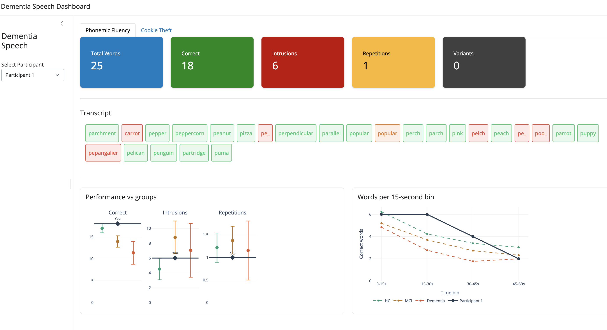
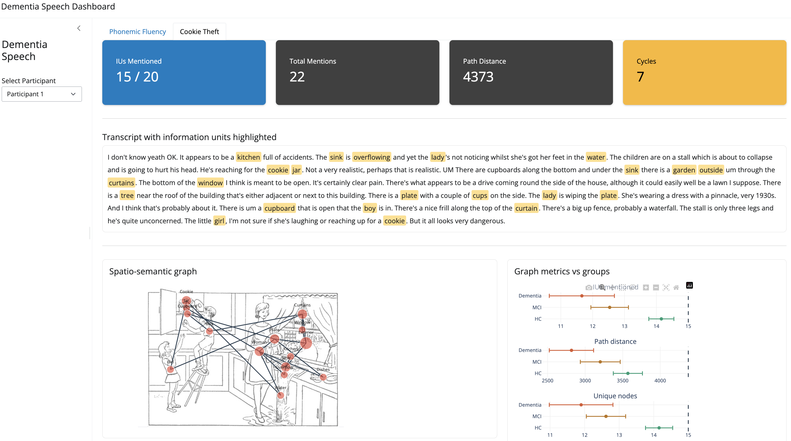

# dementia-speech

A research toolkit for scoring and visualising speech biomarkers from dementia-related clinical tasks, and a Shiny dashboard for per-participant clinical review.

**The work is in progress and this repo does not describe a finished project.**

Tasks currently covered:

| Task | What it measures | How it's scored |
|------|-------------------|------------------|
| **Phonemic Fluency (PFT)** | Words starting with "P" in 60 seconds | Rule-based (`PFT_new`) |
| **Semantic Fluency (SFT)** | Animal names in 60 seconds | Rule-based (`SFT_new`) |
| **Cookie Theft Picture Description (CTD)** | Free description of the Cookie Theft picture | Rule-based information-unit + spatio-semantic graph extraction |
| **Who's concerned?** | Who first raised a memory concern | Local LLM (Qwen) extraction |
| **Finance management** | Whether/why financial management has changed | Local LLM (Qwen) extraction |
| **Memory complaints** | Self-reported memory complaints | Local LLM (Qwen) extraction |
| **Recent news (STN)** | Free recall of a recent news event, matched against a dated news-event cache | Local LLM (Qwen) extraction + code-based date/accuracy scoring |

A fifth, cross-task **Summary** tab combines headline measures from the above into a written bullet summary and a radar chart per participant.

---

## Project structure

```
dementia-speech/
├── src/dementia_speech/            # Core library (installable package)
│   ├── paths.py                    # DATA_DIR resolution (see "Data directory" below)
│   ├── interpretation.py           # Age-adjusted norming (TRAIN-split HC) + percentile scoring
│   ├── io/
│   │   └── textgrid.py             # Praat TextGrid parser
│   └── tasks/
│       ├── PFT_new/                # Phonemic fluency scoring, features, clustering, interpretation
│       ├── SFT_new/                # Semantic fluency scoring, features, clustering, interpretation
│       ├── picture_description/    # Cookie Theft IU extraction, graph metrics, interpretation
│       ├── phonemic_fluency/       # Legacy PFT scorer (superseded by PFT_new)
│       ├── _shared/
│       │   ├── model.py            # Shared Qwen2.5-14B-Instruct loader (GPU only)
│       │   └── redaction.py        # Shared PID-redaction placeholders + grounding check
│       ├── who_concerned/          # schema.py / prompt.py / extract.py / verify.py
│       ├── finance/                # schema.py / prompt.py / extract.py / verify.py
│       ├── memory_complaints/      # schema.py / prompt.py / extract.py / verify.py
│       └── news/                   # schema.py / prompt.py / extract.py / verify.py / retrieval.py / scoring.py
├── pipelines/
│   ├── score_pft_new.py            # PFT scoring
│   ├── score_sft.py                # SFT scoring
│   ├── score_cookie_theft.py       # CTD scoring
│   ├── score_who_concerned.py      # Qwen extraction (GPU)
│   ├── score_finance.py            # Qwen extraction (GPU)
│   ├── score_memory_complaints.py  # Qwen extraction (GPU)
│   ├── score_news.py               # Qwen extraction + date/accuracy scoring (GPU)
│   ├── score_fluency_discrepancy.py# Letter-vs-category fluency discrepancy score
│   ├── build_news_event_cache.py   # Builds the dated news-event lookup table
│   ├── extract_*_transcripts.py    # Transcript extraction/prep scripts per task
│   ├── check_*.py                  # Measure-validation scripts (monotonicity, residualization)
│   └── slurm/                      # sbatch scripts for every GPU pipeline above
├── app/
│   ├── app.py                      # Shiny dashboard entry point
│   ├── study_app.py                # Blinded rater-study variant of the dashboard
│   ├── shared.py                   # Shared data loading and constants
│   └── modules/
│       ├── summary.py              # Cross-task Summary tab (bullets + radar chart)
│       ├── overview.py             # Demographics + qualitative-task overview tab
│       ├── phonemic_fluency.py      # PFT dashboard tab
│       ├── semantic_fluency.py      # SFT dashboard tab
│       └── cookie_theft.py          # CTD dashboard tab
├── docs/                           # Scoring rubrics, decisions log, open issues, PID redaction
├── notebooks/                      # Exploratory Jupyter notebooks
├── tests/
└── environment.yml
```

The `data/` directory (raw transcripts, processed CSVs) is **not in this repo** — see below.

---

## Data directory

Patient transcript data is deliberately kept **outside** this repo, on a separate
path per machine, for data governance reasons. Every script imports `DATA_DIR`
from `dementia_speech.paths` rather than hardcoding a relative path. Set this
once per machine:

```bash
export DEMENTIA_SPEECH_DATA_DIR=/path/to/dementia-speech-data
```

Expected layout under that directory:

```
dementia-speech-data/
├── raw/
│   ├── meta-info.csv               # Participant IDs and diagnosis labels
│   ├── Process_demographics.csv    # Age, assessment_date, process_ID
│   ├── textgrids/PFT/, SFT/        # Praat TextGrid files
│   └── text/CTD/, CRN/, FIN/, MEM/, STN/  # Plain-text transcripts per task
└── processed/                      # All pipeline output CSVs + the news audit log
```

**Filename convention:** `<participant_id>__<task_code>.TextGrid` / `.txt`. Participant
IDs are compound (e.g. `PROCESS-2_rec__001`) — the task code is always the *last*
`__`-delimited segment, so IDs must be reconstructed by joining every segment except
the last, not by splitting on the first `__`.

---

## Installation

```bash
conda env create -f environment.yml
conda activate dementia-speech
pip install -e .
```

The four Qwen-based extraction pipelines additionally require `torch` + `transformers`
and a GPU, and are meant to run via `pipelines/slurm/*.sbatch` on the HPC, not on a
login node or locally. The dashboard never loads the model itself — it only reads the
CSVs those pipelines write.

---

## Pipelines

### Rule-based tasks (PFT, SFT, Cookie Theft)

```bash
python pipelines/score_pft_new.py
python pipelines/score_sft.py
python pipelines/score_cookie_theft.py
```

Each reads transcripts/TextGrids for its task and writes a `*_words.csv` (per-word
classification) and `*_metrics.csv` (participant-level summary) pair to `data/processed/`.
See `docs/pft_new_scoring.md`, `docs/sft_scoring.md`, `docs/cookie_theft_scoring.md`
for the full rubric and measure-validation methodology (headline vs. exploratory
measures, monotonicity + residualization checks) behind each.

### Qwen-based extraction tasks (who_concerned, finance, memory_complaints, news)

Run on the HPC via sbatch, not locally:

```bash
sbatch pipelines/slurm/score_who_concerned.sbatch
sbatch pipelines/slurm/score_finance.sbatch
sbatch pipelines/slurm/score_memory_complaints.sbatch
sbatch pipelines/slurm/score_news.sbatch
```

Each loads Qwen2.5-14B-Instruct, extracts structured fields from the relevant
transcripts, verifies every extracted quote is an exact substring of the real
transcript ("grounding"), and writes one tidy CSV to `data/processed/`. `score_news.py`
additionally matches free-text news recall against a dated event cache
(`build_news_event_cache.py`'s output) and scores recency/accuracy plus a
detail/substance measure — see `docs/news_scoring_rules.md`.

**PID redaction:** all four tasks instruct the model to redact personal names/places
(`[NAME]`/`[PLACE]`) out of any free text before it's written to CSV, with a
grounding check that treats those placeholders as wildcards rather than literal
text. This is a best-effort instruction to the model, not a guaranteed filter —
see `docs/pid_redaction.md` for exactly what it covers, what it doesn't (e.g. the
raw audit log, and the raw-transcript display on the PFT/SFT/Cookie Theft tabs),
and what to spot-check after rerunning these pipelines.

---

## Dashboard

The Shiny dashboard reads pre-computed CSVs and does no scoring or model inference
at runtime.

```bash
shiny run app/app.py --reload
```

Select a participant from the sidebar to view:

- **Summary** — a written bullet summary of where this participant diverges from
  the healthy-control norm (or doesn't), plus a radar chart across fluency,
  picture description, general language, finance, and recent-news domains, with
  each diagnostic group's mean overlaid for reference.
- **Overview** — demographics and the qualitative task findings (who's concerned,
  finance, memory complaints).
- **Fluency** — phonemic and semantic fluency: colour-coded transcript, headline
  + exploratory measure cards (value and age-adjusted percentile, no
  Typical/Borderline/Atypical banding — see "Scoring philosophy" below), temporal
  bin plot, and an experimental letter-vs-category discrepancy score.
- **Cookie Theft** — highlighted transcript showing matched information units,
  IU coverage summary, interactive spatio-semantic graph overlaid on the picture,
  and headline/exploratory measure cards.




---

## Scoring philosophy

- **No fixed Typical/Borderline/Atypical cutoffs.** This cohort's individual-level
  discrimination is modest (AUC ~0.5–0.7 for most single measures), so the
  dashboard shows a continuous, age-adjusted percentile against this project's own
  TRAIN-split healthy-control group instead of a categorical band that would
  overstate confidence.
- **Headline vs. exploratory measures.** A measure is only shown as "headline"
  (validated) if it's monotonic across HC → MCI → Dementia *and* survives
  residualizing against the task's primary measure — i.e. it isn't just restating
  a more basic score. Everything else is shown, but labelled exploratory. See
  `pipelines/check_*.py` and the per-task docs in `docs/` for the checks behind
  this.
- **Missing data is never shown as zero or as the worst value** — e.g. an
  unanswered or "unclear" qualitative question breaks a line on the radar chart
  rather than plotting at the bottom of the scale.

---

## Human evaluation study

A separate Shiny app (`app/study_app.py`) runs a blinded online evaluation: a
rater follows a personal link, works through 20 TEST-split cases making a
diagnosis guess + confidence rating per case, then is pointed to a final
qualitative questionnaire. It reuses the dashboard tabs above unmodified —
they never render a participant's true diagnosis — but replaces the sidebar
participant picker with a fixed, per-rater case sequence.

```bash
shiny run app/study_app.py --reload
```

then visit `http://127.0.0.1:8000/?token=<any-token>` locally to try it (any
string of 8+ letters/digits/`-`/`_` works as a token in dev).

See `docs/study_protocol.md` for the study design decisions, `study/README.md`
for setting up the consent Google Form and Apps Script, and
`docs/study_hosting.md` for exposing the app to the public internet.

---

## Known limitations

- **Recent news scoring is experimental** and currently shown on the Summary
  tab as a fixed placeholder, pending a hand-rating pass (50–100 answers) against
  the pipeline's output — see `docs/news_scoring_rules.md`.
- **CTD synonym matching** uses lexical lookup only; plural and inflected forms
  (e.g. "cookies") are not caught unless explicitly listed.
- **CTD pronoun references** (e.g. "he" for Boy) are not resolved, so cycle
  metrics undercount revisits relative to a human annotator.
- **PID redaction is best-effort**, not a guarantee — see `docs/pid_redaction.md`
  for what it does and doesn't cover.
- **The fluency discrepancy score** (letter vs. category fluency, Wright et al.
  2022) doesn't reproduce the group separation reported in that paper on this
  dataset — shown for reference only, not as a clinical flag.
